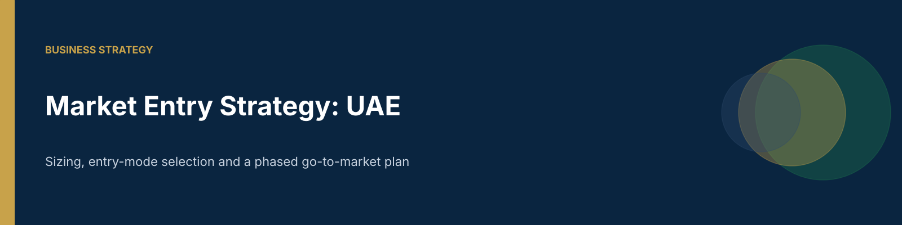
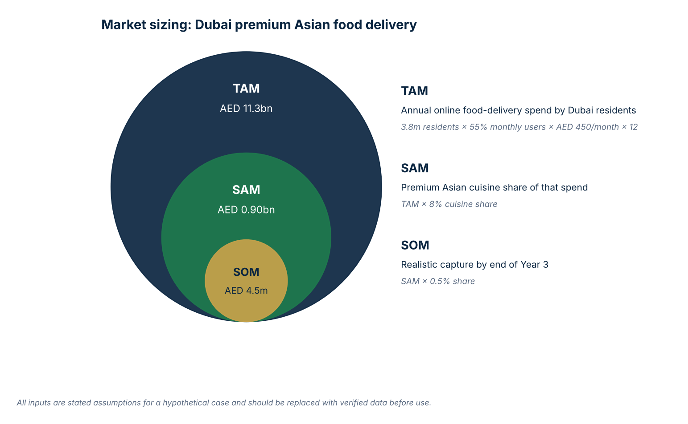
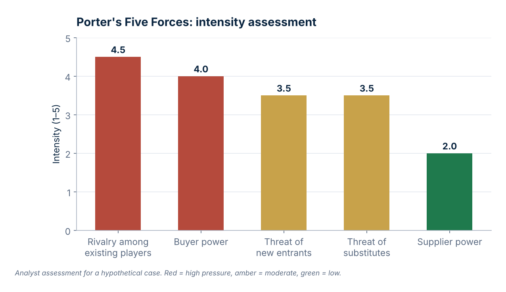
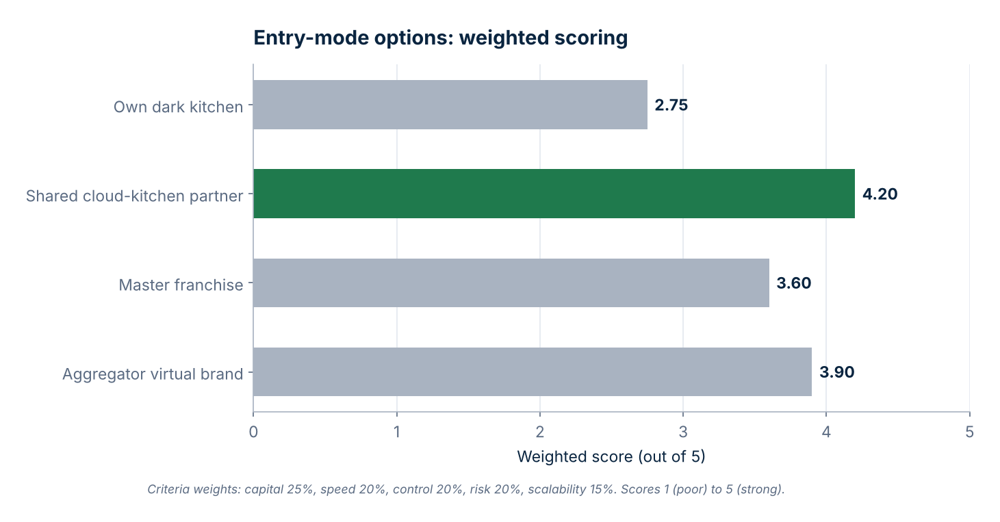
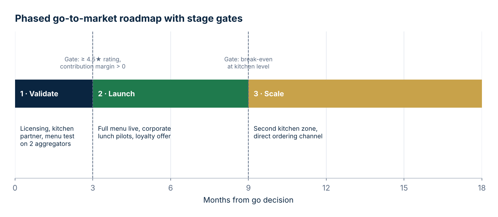

# Market Entry Strategy: Premium Food Delivery in the UAE

**Should a Lahore-based premium food delivery brand enter Dubai, and if so, how?** This project works through that question the way a strategy team would: size the prize, test the market's structure, compare ways in, and turn the answer into a phased plan with clear go/no-go gates.

> **Data note.** The brand is fictional and every number is a stated assumption, built to show the method. All inputs live in one place in the Excel model so they can be replaced with verified data.

---

## 1. The business problem

A founder-led Pakistani food brand has a loyal, premium customer base at home and sees Dubai as a natural next market: a large South Asian and South-East Asian diaspora, high delivery usage and higher price tolerance. The founder's question is not just "is the market big enough?" but "can we enter **without betting the business**?"

## 2. Objectives

1. Estimate the addressable market and a realistic Year-3 revenue ambition.
2. Assess how attractive and how competitive the market is.
3. Compare entry modes on capital, speed, control, risk and scalability.
4. Recommend an entry route with a phased plan and measurable stage gates.

## 3. Approach

| Step | Method | Output |
|---|---|---|
| Size the market | Top-down TAM → SAM → SOM with explicit assumptions | [Market sizing](#4-market-sizing) |
| Read the environment | PESTLE scan | [PESTLE](#5-pestle-summary) |
| Test industry structure | Porter's Five Forces, scored 1–5 | [Five Forces](#6-industry-structure) |
| Compare ways in | Weighted scoring matrix across four entry modes | [Entry options](#7-entry-mode-options) |
| Plan the move | Phased roadmap with go/no-go gates | [Roadmap](#8-recommendation-and-roadmap) |

## 4. Market sizing

| Layer | Logic | Result |
|---|---|---|
| **TAM** | 3.8m residents × 55% monthly delivery users × AED 450/month × 12 | **AED 11.3bn** |
| **SAM** | TAM × 8% premium Asian cuisine share | **AED 0.90bn** |
| **SOM (Year 3)** | SAM × 0.5% share | **AED 4.5m** (≈ 3,100 orders/month at a AED 120 basket) |

**So what?** Even a small share of a niche segment supports a viable kitchen. The real question is cost of entry and speed of learning, not market size.

## 5. PESTLE summary

| Factor | Key consideration | Implication |
|---|---|---|
| Political | Stable, business-friendly environment; free-zone and mainland licensing routes | Choose licence type early; it shapes ownership and where you can trade |
| Economic | High disposable income; high rents and staff costs | Asset-light entry protects cash |
| Social | Large diaspora communities; strong food-delivery habit | Authentic, story-led brand has a natural audience |
| Technological | Aggregator apps dominate discovery | Aggregator presence is essential at launch; direct channel later |
| Legal | Food safety, labelling and trade-licence requirements | Partner with an already-licensed kitchen to shorten time to market |
| Environmental | Packaging and sustainability expectations rising | Budget for compliant, premium packaging |

## 6. Industry structure

Rivalry and buyer power are high: diners can switch in two taps and aggregators control visibility. Supplier power is low. **Implication:** differentiation (authentic, hard-to-copy dishes) and retention matter more than scale.

## 7. Entry-mode options

| Option | Capital | Speed | Control | Risk | Scalability | **Weighted** |
|---|:-:|:-:|:-:|:-:|:-:|:-:|
| Own dark kitchen | 2 | 2 | 5 | 2 | 3 | 2.75 |
| **Shared cloud-kitchen partner** | 4 | 5 | 4 | 4 | 4 | **4.20** |
| Master franchise | 5 | 3 | 2 | 3 | 5 | 3.60 |
| Aggregator-only virtual brand | 5 | 5 | 2 | 4 | 3 | 3.90 |

*Weights: capital 25%, speed 20%, control 20%, risk 20%, scalability 15%. Higher is better on every criterion (e.g. 5 on "capital" means little capital needed).*

## 8. Recommendation and roadmap

**Enter through a shared cloud-kitchen partner.** It is fast and capital-light while keeping control of recipe and brand, which is the source of the differentiation.

| Phase | Months | Focus | Gate to move on |
|---|---|---|---|
| 1 · Validate | 0–3 | Licence, partner kitchen, test menu on two aggregators | Rating ≥ 4.5★ and positive contribution margin |
| 2 · Launch | 3–9 | Full menu, corporate lunch pilots, loyalty offer | Kitchen-level break-even |
| 3 · Scale | 9–18 | Second delivery zone, direct ordering channel | Repeat rate and margin targets held for 3 months |

**Key risks:** licensing delays, aggregator commission changes, early ratings. These are tracked in the companion [Project Delivery Playbook](https://github.com/sohaibshabbir9-del/project-delivery-playbook).

## 9. Deliverables

| File | What it is |
|---|---|
| [`templates/market-entry-model.xlsx`](templates/market-entry-model.xlsx) | Editable sizing model and weighted scoring matrix (yellow cells = inputs) |
| [`assets/`](assets/) | Charts used in this write-up |

## 10. How to use this

1. Download the Excel model.
2. Replace the yellow assumptions with sourced figures (statistics office, aggregator reports, customer survey).
3. Adjust criteria weights to reflect the founder's priorities; the ranking updates automatically.
4. Use the stage-gate table as the basis for an investment or board decision.

---

Prepared by <a href="https://github.com/sohaibshabbir9-del">Sohaib Shabbir</a> · MSc Business Strategy & Entrepreneurship, Cardiff University · Hypothetical case for portfolio purposes.
